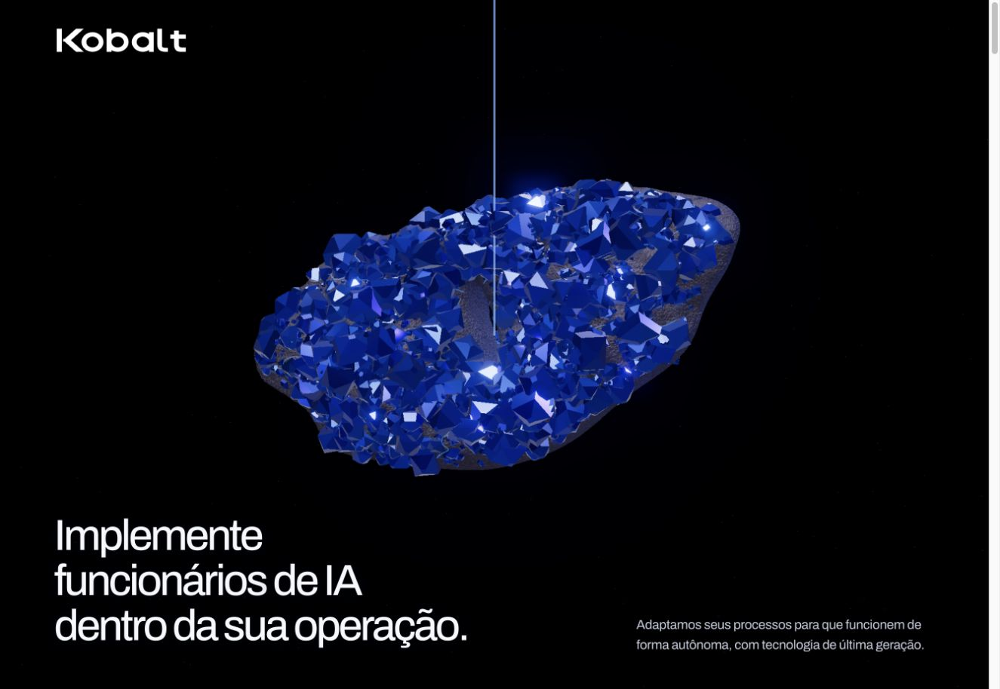

# Kobalt — home visual, versão 20

Entrega da home pública e da hero 3D para integração na plataforma Kobalt.

**Referência publicada:** https://kobalt-home-2026.codex832867.chatgpt.site/



## O que está pronto

- Referência navegável completa em `reference/`, com imagens em arquivos separados.
- Fontes editáveis em `source/home/`: HTML, CSS, JavaScript e gerador Python.
- Textos e métricas em `source/content/` e design system em `source/design-system/`.
- Hero com pedra de geometria 3D real e sequência controlada pelo scroll: despertar, entrada na fissura, transformação em módulos metálicos e revelação da frase sobre fundo branco.
- Three.js e seus módulos locais; Font Awesome oficial, fontes e licenças incluídos.

## Visualizar

Requer Python 3 para servir os arquivos. Na raiz desta entrega:

```sh
python3 -m http.server 8080 --bind 127.0.0.1 --directory reference
```

Abra http://127.0.0.1:8080/. Use HTTP local para os módulos do Three.js; abrir o HTML diretamente pelo gerenciador de arquivos não é o modo de teste suportado. Não há instalação npm nem banco para essa referência.

## Editar e reconstruir

O gerador exige Python 3.12 ou superior, sem pacotes externos:

```sh
python3 source/home/build.py
python3 -m http.server 8080 --bind 127.0.0.1 --directory build
```

O resultado de `build/` reproduz o HTML de origem e copia os módulos necessários. Essa geração não publica o site. A referência de `reference/` é o snapshot da versão 20; não é regravada pelo gerador.

## Passar para a fábrica

Enviar o link deste repositório com acesso de leitura, ou o ZIP desta entrega. Começar por `INTEGRACAO.md` e `MENSAGEM-PARA-FABRICA.txt`.

A entrega é HTML/CSS/JavaScript: a integração na aplicação Next.js/React ainda precisa ser feita pela fábrica. O repositório visual é a referência de apresentação; o repositório canônico da plataforma continua no fluxo atual da fábrica.

`manifest.json` identifica a publicação de origem e contém hashes dos arquivos. O estudo de anúncios permanece disponível em https://kobalt-home-2026.codex832867.chatgpt.site/estudo/ e o guia visual em https://kobalt-home-2026.codex832867.chatgpt.site/design-system/.

## Licenças

Preservar `LICENSES/`, as atribuições dos SVGs do Font Awesome e os avisos dos fornecedores. As licenças incluídas se referem às dependências; não concedem uma licença geral para a marca ou para o material da Kobalt.
